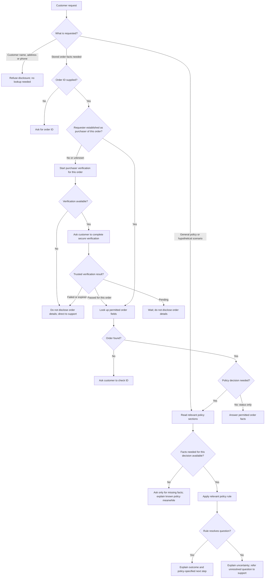
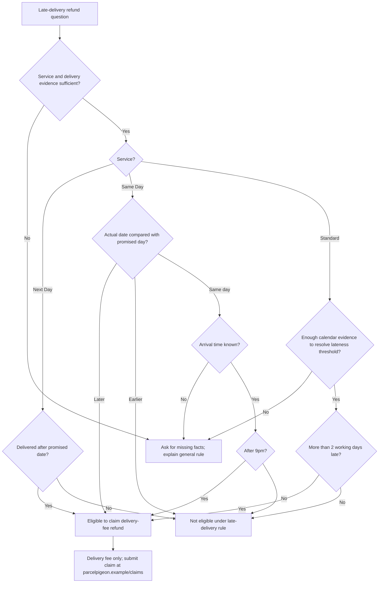

# Policy decision flow

Design only: no runtime gates are implemented. This flow follows `agent/data/policies.md`. Engineering safeguards are distinguished from customer eligibility rules. Handle each part of a multi-part request independently.

## Main flow

The purchaser restriction comes from **Privacy**. The policy does not define verification, and the repo has no verification mechanism. An order ID alone does not establish ownership. This missing integration does not justify authenticating general policy questions. A hypothetical refund explanation can use customer-supplied scenario facts without disclosing stored order details; distinguish that explanation from confirming an actual order's eligibility.

## Purchaser verification gate

An order reference triggers verification when the answer would use or disclose stored order details. Merely mentioning an order while asking a general policy question does not require verification.

Proposed verification procedure (an implementation choice, not a procedure already defined by policy):

1. Obtain the order ID if missing. Do not request it again if already provided.
2. Reuse a trusted signed-in purchaser session if it authorises access to this specific order. Otherwise offer a secure verification challenge, such as a one-time code sent to the purchaser contact already registered with the order.
3. Ask the customer to complete the challenge in the verification interface. Do not ask for photo ID, passwords, payment details, or the full address in chat. A name/postcode match alone must not unlock an order.
4. The backend validates the challenge and binds success to this session and order, with expiry. The model receives only the verification outcome, not the code or registered contact details. An email address or phone number supplied in chat is not an authorised challenge destination.
5. On success, resume the original request using permitted order fields. On pending verification, wait. On failure, expiry, unavailable verification or exhausted attempts, disclose no order details and provide the support contact. Use neutral challenge responses that do not reveal whether an order or contact exists.

Keep separate outcomes: `needs_verification`, `verification_pending`, `verified`, `verification_failed`, and `verification_unavailable`. Limit attempts and make challenges expire in the backend; exact limits belong to the verification service configuration. These controls apply to verification, not to general policy answers.

**What success permits:** status, service, expected delivery and relevant refund/cover information for the authorised order. It does not permit revealing customer name, address or phone number: the current Privacy policy prohibits those disclosures even after verification. Changing that restriction would require an explicit policy change.

**Repo dependency:** order fixtures have no registered email/phone authentication channel, and no challenge service or secure verification interface exists. Do not claim a code was sent or simulate successful verification from customer assertions. Until integrated, use the support fallback. Evaluation may supply trusted verification fixtures, clearly separate from real verification.

## Late-delivery refunds

Use the known promised delivery date where available. Reconstruct it from order time, cut-off and calendar only when necessary.

- Still-undelivered parcels do not need a fabricated actual delivery date. Explain the rule and claim route; refer unresolved eligibility or lost-parcel questions to support.
- For Standard, check working days only when needed. Delivery on or before the promised date is not late without any holiday lookup. Exactly two working days late does not meet “more than 2”. Regional bank holidays and precise counting conventions remain unspecified; clarify only when they affect the outcome.
- For Same Day, delivery on a later date establishes lateness without a timestamp. Time is needed to assess the 9pm boundary on the promised day.
- Assistants cannot issue refunds. State the five-working-day processing period and original payment method when relevant; the policy does not specify when processing starts.
- The item-value exclusion applies to late-delivery refunds. It does not remove separate lost/damaged compensation rights under the company policy.

## Rules by topic

Run only rules relevant to the question. Do not demand facts needed for a personalised decision when explaining a general policy.

| Policy section | Decision boundary | Ask or clarify only when needed |
|---|---|---|
| Delivery services and prices | Up to 2 kg: Standard £3.95; Next Day £6.50; Same Day £12.00. Above 2 kg: extra £1.50 per kg. Above 20 kg exceeds the service limit. | Exact fractional-weight pricing needs an agreed rounding rule. No order lookup needed for a quote. |
| Order cut-off times / Working days | Next Day: 4pm on a working day. Same Day: 11am, London postcodes only; by 9pm on processing day. After cut-off: next working day. Revised Same Day wording also moves non-working-day orders to the next working day. | Time, location and calendar matter for calculating a particular promise. Saturday delivery and regional holiday applicability remain unclear. |
| Late deliveries and refunds | Apply subtree above. Delivery-fee refund only; assistant cannot issue it; customer submits claim. | No identity or order data required merely to explain the policy. |
| Lost or damaged parcels | Report lost parcels within 28 days of expected delivery; damage within 7 days of delivery, with photos. Ordinary compensation cap: £50. | Dates and photos matter for a particular claim, not for stating the reporting window. No definition of when delayed becomes lost. |
| Pigeon Protect cover | £2.50, added at checkout; cannot be added after sending. Compensation up to declared value, capped at £500. | Declared value needed for a personalised cap, not to explain the £500 maximum. Caps do not guarantee payouts. No compensation payment process specified. |
| Prohibited items | Do not carry standalone lithium batteries, aerosols, perfume over 100 ml, cash, live animals or illegal goods. | Ask quantity or packaging details when relevant. Do not extend the perfume restriction to all liquids or the standalone-battery restriction to all battery-containing items. |
| Changing a delivery address | Allowed before out-for-delivery; cannot change from that stage onward. | Status needed for actual-order eligibility. Exceptional/unknown statuses may need clarification; no change channel specified. |
| Privacy | Share order details only with purchaser. Never disclose customer name, address or phone number, including to purchaser. | No lookup or verification needed to refuse prohibited disclosure. |
| Contact | Monday–Saturday, 8am–8pm; help@parcelpigeon.example. | Support hours do not establish delivery days. |

## Engineering safeguards, separate from policy

- Enforce purchaser access and remove name/address/phone in the tool layer. Do not trust model-supplied identity claims.
- Use pure rule functions returning outcome, policy section and missing facts; the model explains the result.
- Retrieve policy sections only when a policy decision needs them. Status-only answers do not require policy search. Irrelevant keyword-search results are not adequate evidence.
- Current tools are read-only: do not claim an action succeeded. Refund issuance is additionally forbidden explicitly by policy. Do not invent the same claims process for compensation.
- Templates and output validation are optional implementation choices, not extra eligibility gates. A mandatory second model call or keyword scan is not required by policy and cannot guarantee alignment.
- Off-topic refusal and injection resistance are workshop/system behaviour, not rules in the customer policies; handle them separately.

The starter order-status test has no purchaser context. Enforcing Privacy requires trusted test context or a changed expectation; this integration does not exist yet.

## Focused checks

1. General price or refund-policy question: no order lookup or purchaser check.
2. Prohibited personal-data request: refuse without fetching record.
3. Stored order disclosure: request missing verification, wait while pending, then resume only on a trusted success for that specific order and session.
4. Status-only request from established purchaser: no mandatory policy search.
5. Standard refund: exactly two working days late fails eligibility; more than two qualifies; on-time delivery needs no holiday calculation.
6. Same Day refund: later date qualifies without timestamp; same-date arrival needs time to resolve 9pm.
7. Late-delivery claim: delivery fee only, claim link, no assertion payment was issued.
8. Pigeon Protect: explain £500 cap without demanding declared value; require value only for personalised cap.
9. Address change: before versus from out-for-delivery; never claim a read-only tool changed it.
10. Multi-part request: answer permitted parts while refusing restricted disclosure.
11. A supplied name, postcode, code-like string or claim of identity does not itself mark verification successful; only the backend result does.
12. Verification for one order/session does not unlock another; expired/failed/unavailable challenges disclose no order details.
13. Successful verification still does not permit disclosure of name, address or phone number.
14. An order mention in a general policy question does not trigger an unnecessary challenge; existing valid purchaser context avoids a repeated challenge.

These are proposed tests, not executed runtime checks or proof that natural-language routing is always correct.
